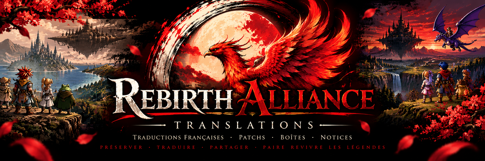
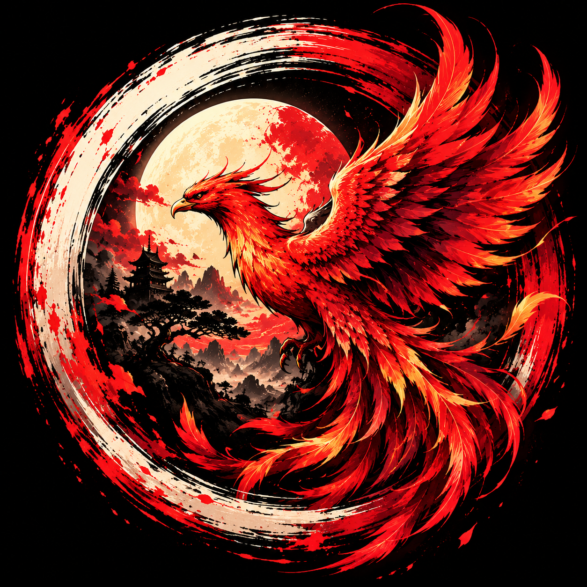

  

## Soutenir le projet

Toutes les traductions françaises proposées par Rebirth Alliance Translations sont partagées gratuitement.

Si vous appréciez mon travail et souhaitez encourager la poursuite de ces projets, vous pouvez me soutenir librement sur Ko-fi.

[Soutenir Rebirth Alliance Translations sur Ko-fi](https://ko-fi.com/rebirthalliancetranslations)

Merci pour votre soutien et votre passion pour le rétrogaming !
  
# Rebirth Alliance Translations

### Redonnons vie aux légendes du jeu vidéo !

Bienvenue sur la page officielle de **Rebirth Alliance Translations** !

Après 15 années consacrées à la passion du rétrogaming, une nouvelle aventure commence.

Notre objectif : préserver l'héritage des jeux vidéo qui ont marqué notre enfance, les rendre accessibles aux joueurs francophones et partager nos créations avec toute la communauté.

Nous réalisons et partageons des **patchs de traduction française**, des créations de boîtes et de notices ainsi que divers projets autour de la Super Nintendo.

---

##  Nos projets / Our Projects

| Jeu | Projet à venir |
|---|---|
| Chrono Trigger: Flames of Eternity | Traduction française en développement |
| Chrono Trigger: Prophet's Guile | Refonte de l'écran de démarrage |
| Breath of Fire | Mise à jour du patch français |
| Breath of Fire II | Traduction française — sortie prochaine |
| Bahamut Lagoon | Retraduction depuis les scripts japonais |

---

## 📦 Téléchargements

Nos patchs seront proposés gratuitement dans les sections de téléchargement de nos dépôts GitHub.

**Aucune ROM commerciale n'est distribuée.**

## Soutenir nos créations

Rebirth Alliance Translations est avant tout un projet de passion.

Si vous appréciez notre travail et souhaitez nous encourager, vous pourrez prochainement nous soutenir par un pourboire volontaire.

Les traductions restent gratuites et accessibles à tous.

---

## English

**Welcome to Rebirth Alliance Translations!**

After 15 years of dedication to retro gaming, a new adventure begins.

Our mission is to preserve the legacy of classic video games through French fan translations, ROM patches, custom box art and manuals.

We focus primarily on Super Nintendo classics, sharing our work freely with the retro gaming community.

**Preserving the past. Translating the legends.**

---

*Rebirth Alliance Translations — Une passion, un héritage, une renaissance.*<!--
**Rebirth-Alliance-Translations/Rebirth-Alliance-Translations** is a ✨ _special_ ✨ repository because its `README.md` (this file) appears on your GitHub profile.

Here are some ideas to get you started:

  

